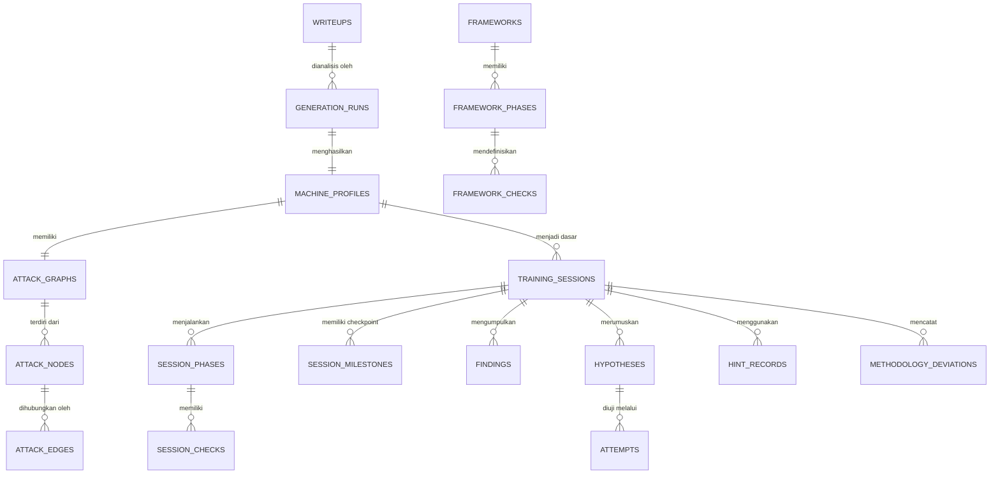

# CTF Methodology Trainer — Product Requirements Document (PRD)

> **Dokumen Kontrol Produk**  
> **Nama Produk:** CTF Methodology Trainer  
> **Versi Dokumen:** 1.0 (Human-Centered Baseline)  
> **Status:** Disetujui & Terverifikasi Penuh (*Approved / Production Baseline*)  
> **Target Rilis:** MVP (*Minimum Viable Product* — Tahap 01 s/d Tahap 30)  
> **Platform & Teknologi:** Desktop-Oriented Local-First Web Application (Next.js 16 App Router, PostgreSQL, Drizzle ORM, Tailwind CSS v4, Google Gemini API)  
> **Kategori Produk:** *Cybersecurity Education & Evidence-Driven Methodology Training Companion*

---

## Ringkasan Eksekutif (*Executive Summary*)

**CTF Methodology Trainer** adalah aplikasi pendamping pembelajaran penetrasi keamanan siber (*penetration testing*) lokal (*local-first companion*) yang dirancang untuk mengatasi masalah paling mendasar pada komunitas praktisi keamanan siber dan pemain *Capture The Flag* (CTF): **kebiasaan menyerang secara acak (*random guessing/fuzzing*), ketergantungan berlebihan pada *walkthrough/writeup* yang merusak proses belajar, pengabaian metodologi formal, dan jebakan jalan buntu (*rabbit holes*) yang tidak terarah.**

Platform CTF konvensional (seperti Hack The Box, TryHackMe, VulnHub, atau Proving Grounds) menyediakan mesin rentan (*vulnerable machine*), namun menyerahkan proses eksplorasi sepenuhnya kepada pengguna tanpa bimbingan terstruktur. Akibatnya, pemula sering kali terjebak dalam siklus frustrasi: menjalankan pemindaian port, bingung menentukan prioritas, langsung membuka *writeup*, menyalin perintah eksploitasi mentah-mentah (*copy-paste exploit*), dan mendapatkan *root* tanpa memahami proses pengambilan keputusan di baliknya.

CTF Methodology Trainer mengubah paradigma ini secara radikal: **Aplikasi tidak pernah menyerang target secara otomatis, dan tidak pernah memberikan contekan langkah eksploitasi.** Sebagai gantinya, aplikasi mengonversi dokumen *writeup* resmi menjadi **Pengetahuan Tersembunyi (*Hidden Machine Knowledge & Attack Graph*)** yang disimpan rapat di sisi server. Pengetahuan ini menjadi kompas bagi *deterministic methodology engine* berbasis standar PTES (*Penetration Testing Execution Standard*) untuk:

1. Menjaga disiplin pengujian pengguna (*Methodology Before Exploit*).
2. Membuka panduan dan *checklist* hanya berdasarkan bukti nyata yang ditemukan dan dikonfirmasi oleh pengguna (*Evidence Before Action*).
3. Melatih perumusan hipotesis ilmiah sebelum melakukan pengujian eksploitasi (*Hypothesis Before Random Testing*).
4. Memberikan asistensi mentor AI progresif tingkat 0–6 tanpa membocorkan jawaban (*Guidance Without Spoilers*).
5. Membuka komparasi jalur resmi (*Reference Path*) dan metrik disiplin hanya setelah mesin berhasil diselesaikan (*Post-Session Reflection*).

```
+----------------------------------------------------------------------------------------------------+
|                         NILAI UTAMA PRODUK CTF METHODOLOGY TRAINER                                 |
+----------------------------------------------------------------------------------------------------+
|                                                                                                    |
|    [ DOKUMEN WRITEUP SUMBER ]                    [ DISIPLIN PENETRATION TESTER ]                   |
|    - Dokumen PDF, Markdown, TXT                  - Menguji target manual di Kali Linux             |
|    - Ekstraksi fakta rahasia oleh AI             - Mengumpulkan bukti (port, banner, service)      |
|    - Graf serangan tersembunyi (Server-only)     - Merumuskan hipotesis & mencatat attempt         |
|    - Kunci jawaban terisolasi                    - Menuntaskan Phase Gate secara sadar             |
|                                                                                                    |
|                                 \                     /                                            |
|                                  \                   /                                             |
|                                   v                 v                                              |
|                         +-----------------------------------+                                      |
|                         |  DETERMINISTIC METHODOLOGY ENGINE |                                      |
|                         |  - Metodologi PTES 6-Fase         |                                      |
|                         |  - Checklist dinamis berbasis hak |                                      |
|                         |  - AI Mentor progresif (Level 0-6)|                                      |
|                         |  - Evaluasi metrik & Review rute  |                                      |
|                         +-----------------------------------+                                      |
|                                                                                                    |
+----------------------------------------------------------------------------------------------------+
```

---

## Daftar Isi

1. [Latar Belakang & Analisis Masalah](#1-latar-belakang--analisis-masalah)
2. [Visi Produk, Nilai Inti & Sasaran Sukses](#2-visi-produk-nilai-inti--sasaran-sukses)
3. [Batasan Cakupan Produk (Scope Boundaries & Non-Goals)](#3-batasan-cakupan-produk-scope-boundaries--non-goals)
4. [Persona Pengguna & Cerita Pengguna (User Stories)](#4-persona-pengguna--cerita-pengguna-user-stories)
5. [Alur Pengguna & Pengalaman Antarmuka (User Journey & UX)](#5-alur-pengguna--pengalaman-antarmuka-user-journey--ux)
6. [Kebutuhan Fungsional Produk (Functional Requirements)](#6-kebutuhan-fungsional-produk-functional-requirements)
7. [Model Data Konseptual (Data Dictionary)](#7-model-data-konseptual-data-dictionary)
8. [Filosofi Keamanan & Privasi Produk](#8-filosofi-keamanan--privasi-produk)
9. [Kebutuhan Non-Fungsional (Kualitas Sistem)](#9-kebutuhan-non-fungsional-kualitas-sistem)
10. [Panduan Desain Antarmuka & Sistem Visual](#10-panduan-desain-antarmuka--sistem-visual)
11. [Kriteria Penerimaan & Skenario Sukses (Acceptance Criteria)](#11-kriteria-penerimaan--skenario-sukses-acceptance-criteria)
12. [Rencana Rilis & Milestone Roadmap (Tahap 01 – 30)](#12-rencana-rilis--milestone-roadmap-tahap-01--30)
13. [Manajemen Risiko & Pertimbangan Desain](#13-manajemen-risiko--pertimbangan-desain)

---

## 1. Latar Belakang & Analisis Masalah

### 1.1 Masalah Fundamental dalam Pembelajaran CTF
Dalam melatih keterampilan uji penetrasi keamanan siber (*ethical hacking*), praktisi pemula maupun menengah sering menghadapi rintangan psikologis dan metodologis:

1. **Sindrom "Nmap Langsung Exploit" (*The Tool-Jumping Trap*):**  
   Banyak pembelajar menjalankan `nmap`, melihat satu port HTTP terbuka, langsung membuka SearchSploit atau Metasploit, lalu menembakkan eksploitasi secara membabi buta tanpa mengidentifikasi versi, banner, teknologi web, atau konfigurasi khusus. Jika gagal, mereka bingung dan tidak memiliki rencana cadangan.
2. **Ketergantungan Merusak pada Walkthrough (*Spoiler Addiction*):**  
   Saat menemui jalan buntu selama 30 menit, mayoritas pembelajar membuka *writeup* lengkap di blog atau YouTube. Mengetahui jawaban secara instan melenyapkan momen kritis pembentukan intuisi investigasi (*investigative thinking*). Begitu jawaban dibaca, kesempatan belajar mandiri pada mesin tersebut hilang selamanya.
3. **Frustrasi Jalan Buntu Tanpa Kompas (*The Rabbit Hole Despair*):**  
   Pada mesin yang rumit, pembelajar sering menghabiskan waktu 4 jam mengutak-atik direktori yang tidak penting atau layanan umpan (*rabbit hole*). Tanpa bimbingan terkalibrasi, mereka tidak tahu apakah mereka sedang berada di jalur yang benar atau sedang membuang waktu.
4. **Ketiadaan Refleksi Pasca-Latihan (*No Systematic Debriefing*):**  
   Setelah mendapatkan *root flag*, mayoritas pembelajar langsung menutup mesin tanpa pernah meninjau kembali: *"Berapa banyak langkah tidak perlu yang saya lakukan?", "Apakah saya melewatkan tahap enumerasi penting?", "Bagaimana alur resmi yang sebenarnya dirancang oleh pembuat mesin?"*

### 1.2 Solusi CTF Methodology Trainer
CTF Methodology Trainer menghadirkan ekosistem latihan yang bertindak layaknya **Mentor Penetrasi Senior di Samping Anda**:
* **Metodologi sebagai Pengendali (*Methodology First*):** Alur latihan dipandu oleh 6 fase standar PTES: *Reconnaissance*, *Scanning & Enumeration*, *Threat Modeling*, *Vulnerability Analysis*, *Exploitation*, dan *Post Exploitation*.
* **Aktivasi Terkondisi Bukti (*Evidence-Driven UI*):** Checklist layanan (misalnya HTTP Playbook) tidak akan pernah muncul hanya karena *writeup* mengatakan ada web server; checklist baru aktif setelah pengguna sendiri memasukkan bukti temuan port 80/443.
* **Mentor Tanpa Spoiler (*Progressive Guidance*):** Jika buntu, pengguna meminta petunjuk berjenjang (Level 0 s/d 6). AI Mentor mengarahkan pola pikir (*"Perhatikan respons header cookie"*), bukan memberikan jawaban mentah (*"Gunakan exploit CVE-2023-XXXX"*).
* **Evaluasi & Refleksi Deterministik:** Setelah mesin selesai, sistem menampilkan grafik perbandingan antara *User Path* (rute eksplorasi pengguna) dengan *Reference Path* (jalur resmi *writeup*) disertai skor kepatuhan fase dan cakupan enumerasi.

---

## 2. Visi Produk, Nilai Inti & Sasaran Sukses

### 2.1 Visi Produk
> *"Menjadi platform pendamping pelatihan penetrasi keamanan siber nomor satu yang membangun kebiasaan metodologis, disiplin investigasi berbasis bukti, dan ketajaman analisis tanpa merusak kenikmatan memecahkan teka-teki keamanan siber."*

### 2.2 Sembilan Aturan Inti Produk (*Core Invariants*)

```text
1. METHOD BEFORE EXPLOIT          — Metodologi selalu mendahului aksi eksploitasi.
2. EVIDENCE BEFORE ACTION         — Setiap tindakan harus didasari bukti yang valid.
3. ENUMERATION BEFORE ASSUMPTION  — Dilarang berasumsi sebelum enumerasi tuntas.
4. HYPOTHESIS BEFORE RANDOM TEST  — Uji coba harus berbasis hipotesis terencana.
5. GUIDANCE WITHOUT SPOILERS      — Bimbingan tidak boleh membocorkan jawaban langsung.
6. VISIBLE CONTEXT FROM EVIDENCE  — Konteks terlihat murni berasal dari temuan pengguna.
7. AI ASSISTS, METHOD DECIDES     — AI hanya membantu analisis, mesin metodologi yang memutuskan.
8. FRONTEND RENDERS DATA          — Antarmuka bersifat skema generik, bukan logika mesin.
```

### 2.3 Sasaran Kualitatif & Kuantitatif Produk (G-01 – G-05)

| ID | Sasaran Produk | Indikator Keberhasilan (Target KPI) | Cara Evaluasi |
|---|---|---|---|
| **G-01** | **Isolasi Rahasia Mutlak** | 0% kebocoran rahasia (*zero spoiler leakage*) ke browser klien sebelum sesi selesai. | Security boundary audit & automated network inspection. |
| **G-02** | **Disiplin Metodologi PTES** | 100% transisi fase diatur oleh *Phase Gate Deterministic Engine*. | Pengujian unit dan integrasi aturan Phase Gate. |
| **G-03** | **Kemandirian Berpikir Pengguna** | > 70% pengguna berhasil mencapai *initial access* dengan petunjuk <= Level 3 (petunjuk konseptual/arah). | Analisis riwayat penggunaan petunjuk (*hint records*). |
| **G-04** | **Ketahanan Lingkungan Lokal** | 100% fitur utama metodologi, catatan, hipotesis, dan checklist tetap aktif saat offline / AI gagal. | Pengujian simulasi pemutusan API Gemini (*graceful degradation*). |
| **G-05** | **Kecepatan Respons Lokal** | Responsivitas interaksi lokal (checklist, finding, gate) < 100 ms. | Pengukuran latensi runtime pada desktop browser. |

---

## 3. Batasan Cakupan Produk (Scope Boundaries & Non-Goals)

```
+----------------------------------------------------------------------------------------------------+
|                                    MATRIKS RUANG LINGKUP MVP                                       |
+----------------------------------------------------+-----------------------------------------------+
|               DI DALAM CAKUPAN (IN-SCOPE)          |           DI LUAR CAKUPAN (NON-GOALS)         |
+----------------------------------------------------+-----------------------------------------------+
| - Ingest dokumen writeup (PDF, Markdown, TXT)      | - Eksekusi eksploit otomatis ke target VM     |
| - Ekstraksi fakta rahasia via Gemini API           | - Scanner kerentanan otomatis (Nmap/Nessus)   |
| - Pembentukan graf serangan tersembunyi (Server)   | - Penyediaan virtual machine / target hosting |
| - Verifikasi otomatis graf (Solvability check)     | - Fitur multiplayer / leaderboard kompetisi   |
| - Mesin PTES 6-Fase dengan Phase Gate deterministik| - Integrasi reverse shell / terminal di web   |
| - Checklist dinamis berbasis Playbook Registry     | - Penilaian berbasis skor angka subjektif AI  |
| - Pencatatan Bukti, Temuan, Hipotesis, dan Attempt | - Penyimpanan cloud publik multi-tenant       |
| - AI Mentor progresif (Level 0 s/d 6)              | - Dukungan perangkat mobile layar sempit      |
| - Session Review & Pembukaan Graf Solusi           | - Otomasi pelaporan komersial PDF korporat    |
+----------------------------------------------------+-----------------------------------------------+
```

### 3.1 Alasan Pemilihan Non-Goals (*Product Rationale*)
* **Mengapa tidak ada penyerangan otomatis (*No Auto-Attack*)?**  
  Tujuan aplikasi adalah melatih otak dan keterampilan manusia. Jika aplikasi meluncurkan payload otomatis, pengguna menjadi penonton pasif dan kehilangan esensi pembelajaran praktis.
* **Mengapa Target VM tidak dikelola aplikasi?**  
  Pengguna menjalankan Kali Linux dan VM target (misal via VirtualBox/VMware atau VPN HackTheBox) secara independen. Ini memastikan keamanan lingkungan lokal dan memberikan kebebasan penuh bagi pengguna untuk menggunakan peralatan (*tools*) pilihannya sendiri.
* **Mengapa skor evaluasi tidak ditentukan oleh AI?**  
  AI rentan mengalami halusinasi dan inkonsistensi penilaian (*non-deterministic grading*). Seluruh skor (*Phase Gate Compliance*, *Recon Coverage*, *Hypothesis Discipline*) dihitung dengan rumus matematika deterministik berbasis aksi nyata pengguna. AI hanya bertugas memberikan ulasan naratif kualitatif.

---

## 4. Persona Pengguna & Cerita Pengguna (User Stories)

### 4.1 Persona Pengguna

```
+----------------------------------------------------+-----------------------------------------------+
| PERSONA 1: PEMBELAJAR KEAMANAN SIBER (ARGA)        | PERSONA 2: INSTRUKTUR / LEAD PENTESTER (DIAN) |
+----------------------------------------------------+-----------------------------------------------+
| Profil:                                            | Profil:                                       |
| - Mahasiswa / Junior Security Analyst (22 th)      | - Senior Pentester & Pelatih Lab Internal     |
| - Sering bermain CTF tapi mudah buntu dan frustrasi| - Ingin melatih tim junior agar tidak ceroboh |
| Kebutuhan:                                         | Kebutuhan:                                    |
| - Panduan terstruktur saat mencoba mesin baru      | - Standardisasi alur kerja penetrasi tim      |
| - Bantuan saat mentok tanpa merusak keseruan solve | - Evaluasi kebiasaan berpikir anak didik      |
| Titik Frustrasi:                                   | Titik Frustrasi:                              |
| - Sering langsung buka writeup & merasa bersalah   | - Anggota tim mengabaikan pencatatan bukti    |
| - Menghabiskan waktu 5 jam di rabbit hole palsu    | - Laporan penetrasi berantakan tanpa metodologi|
+----------------------------------------------------+-----------------------------------------------+
```

### 4.2 Matriks Cerita Pengguna (*User Stories*)

| ID | Sebagai... | Saya Ingin... | Agar... | Prioritas |
|---|---|---|---|:---:|
| **US-01** | Pengguna | Mengunggah file writeup mesin (PDF/MD/TXT) | Sistem dapat mengekstrak pengetahuan mesin secara tersembunyi. | **P0 (Must)** |
| **US-02** | Pengguna | Memulai sesi latihan baru berbasis writeup | Saya memiliki ruang kerja investigasi yang bersih dan terisolasi. | **P0 (Must)** |
| **US-03** | Pengguna | Melihat checklist metodologi PTES sesuai fase aktif | Saya tahu langkah investigasi standar yang harus dilakukan. | **P0 (Must)** |
| **US-04** | Pengguna | Mencatat temuan bukti (*findings*) seperti port dan banner | Temuan saya terdokumentasi dan mengaktifkan checklist terkait. | **P0 (Must)** |
| **US-05** | Pengguna | Mengonfirmasi temuan (*confirm finding*) | Playbook layanan spesifik (misal HTTP) otomatis aktif di checklist. | **P0 (Must)** |
| **US-06** | Pengguna | Merumuskan hipotesis sebelum melakukan eksploitasi | Saya menguji sistem secara ilmiah dan terarah, bukan acak. | **P0 (Must)** |
| **US-07** | Pengguna | Mencatat hasil percobaan (*attempts*) dari hipotesis | Riwayat keberhasilan atau kegagalan serangan terekam jelas. | **P0 (Must)** |
| **US-08** | Pengguna | Melewati *Phase Gate* dengan konfirmasi kepatuhan | Saya tidak melompat ke fase eksploitasi sebelum enumerasi tuntas. | **P0 (Must)** |
| **US-09** | Pengguna | Meminta petunjuk progresif (*Level 0 s/d 6*) saat buntu | Saya mendapatkan dorongan arah berpikir tanpa terkena spoiler. | **P0 (Must)** |
| **US-10** | Pengguna | Menandai sesi latihan selesai (*Complete Session*) | Saya dapat membuka evaluasi menyeluruh dan graf solusi resmi. | **P0 (Must)** |
| **US-11** | Pengguna | Melihat komparasi *User Path* vs *Reference Path* | Saya mengetahui efisiensi rute saya dibandingkan rute pembuat mesin. | **P0 (Must)** |
| **US-12** | Pengguna | Membaca referensi metodologi dan *Knowledge Base* | Saya dapat belajar teori pengujian berbagai protokol secara mandiri. | **P1 (Should)** |
| **US-13** | Pengguna | Mengonfigurasi Gemini API Key dan display density | Aplikasi sesuai dengan preferensi visual dan kuota AI saya. | **P1 (Should)** |
| **US-14** | Pengguna | Menggunakan Smart Context Chips dan Shortcut Finding-to-Hypothesis | Saya dapat mencatat temuan dan memformulasikan hipotesis secara instan tanpa pengetikan berulang. | **P0 (Must)** |
| **US-15** | Pengguna | Menggunakan AI Auto-Draft pada form hipotesis | AI membantu melengkapi reasoning, expected result, dan test approach secara otomatis dengan kendali penuh di tangan saya. | **P0 (Must)** |
| **US-16** | Pengguna | Mengakses penjelasan kontekstual 3-layer dan perintah konkret pada setiap item checklist | Saya memahami alasan metodologi, risiko bahaya/rabbit-hole, dan contoh sintaks alat tanpa meninggalkan konteks latihan. | **P0 (Must)** |

---

## 5. Alur Pengguna & Pengalaman Antarmuka (User Journey & UX)

### 5.1 Alur Utama Pembuatan Sesi Pelatihan (*New Training Generation*)

```
[ Halaman /training/new ]
       ↓
[ Unggah File Writeup (PDF/MD/TXT) ] ──> Validasi Ukuran (Maks 10MB) & Integritas File
       ↓
[ Pipeline Orkestrasi Otomatis (Server-Side) ]
  ├── 1. Ekstraksi Teks Writeup
  ├── 2. Ekstraksi Fakta via Gemini (Target, OS, Port, Vuln, Flag, Credentials)
  ├── 3. Konstruksi Graf Serangan Tersembunyi (Nodes & Edges)
  └── 4. Verifikasi Deterministik Graf (Solvability, Terminal Node, Non-Empty)
       ↓
[ Pratinjau Profil Mesin (Machine Profile) ] ──> Nama Mesin, OS, Tingkat Kesulitan
       ↓
[ Klik "Start Training" ] ──> Inisialisasi Sesi Baru di Database ──> Masuk ke Workspace
```

### 5.2 Alur Utama Ruang Kerja Latihan (*Training Workspace Execution*)

```
[ Masuk /training/[sessionId] (Fase Awal: Reconnaissance) ]
       ↓
[ Pengguna Menjalankan Nmap Manual di Kali Linux ]
       ↓
[ Pengguna Menambahkan Finding Baru ] ──> Contoh: "Port 80/tcp open HTTP Apache 2.4.41"
       ↓
[ Status Finding: Inferred ──> Pengguna Klik "Confirm Finding" ]
       ↓
[ Context Engine & Playbook Resolver Mendeteksi Layanan HTTP ]
       ↓
[ HTTP Playbook Checklist Muncul Secara Dinamis di Checklist Section ]
       ↓
[ Pengguna Menyelesaikan Checklist Wajib (Required Checks) ]
       ↓
[ Pengguna Mengajukan Transisi Fase (Phase Gate) ]
       │
       ├───> Jika Ada Checklist Required Belum Selesai:
       │        Tampilkan Modal Peringatan Pelanggaran Metodologi (*Deviation Warning*)
       │        (Pengguna boleh memaksa lanjut, dicatat sebagai Methodology Deviation)
       │
       └───> Jika Seluruh Checklist Required Selesai:
                Fase Berpindah Secara Bersih (Misal: ke Scanning & Vulnerability Analysis)
```

### 5.3 Spesifikasi Halaman & Ruang Kerja Antarmuka

#### 1. Dashboard Utama (`/`)
* **Header Metrik:** Ringkasan aktivitas latihan (Sesi Aktif, Mesin Selesai, Total Temuan, Skor Metodologi Rata-rata).
* **Kartu Sesi Terakhir (*Continue Training Card*):** Akses instan 1-klik untuk melanjutkan sesi latihan yang sedang berjalan.
* **Peramban Sesi (*Session Browser*):** Daftar seluruh sesi dengan filter status (*In Progress*, *Completed*), label OS, tingkat kesulitan, dan dropdown aksi (Buka, Rename, Reset, Hapus Permanen).

#### 2. Ruang Kerja Sesi Latihan (`/training/[sessionId]`)
* **Top Phase Stepper:** Indikator visual progres 6 fase PTES (*Reconnaissance* -> *Scanning* -> *Threat Modeling* -> *Vulnerability Analysis* -> *Exploitation* -> *Post Exploitation*). Menampilkan status fase (*Locked*, *Active*, *Completed*) dan tombol *Phase Gate Action*.
* **Kolom Kiri (Methodology & Checklist Panel):**
  - Render dinamis grup checklist (*Core Methodology*, *Playbook Layanan*, *AI Suggested*).
  - Tanda prioritas (*Required* merah/oranye, *Recommended* biru, *Suggested* abu-abu).
  - Indikator asal-usul checklist (*Provenance Badge*).
  - **Contextual Checklist Explanation & Commands Dialog:** Kartu penjelasan 3-layer pada setiap item checklist (Alasan Metodologis, Peringatan Bahaya / Rabbit-Hole, dan Dialog Contoh Perintah Terminal Praktis).
  - **Navigasi Fase Fleksibel & Cek Reversibel:** Pengguna dapat meninjau fase terdahulu tanpa merusak state, membatalkan checklist jika bukti keliru, dan melihat peringatan deviasi secara proaktif.
* **Kolom Tengah (Investigation Workstation):**
  - Tabulasi kerja: **Findings** (bukti & layanan), **Hypotheses** (rumusan pengujian), **Attempts** (eksekusi pengujian), **Notes** (catatan bebas).
  - **Smart Context Chips:** 12 tombol saran konteks siap klik (`HTTP`, `SSH`, `SMB`, `FTP`, `DNS`, `MySQL`, `local-shell`, `root-shell`, `Linux`, `Windows`, `web`, `auth`) pada form temuan (Add & Edit) untuk eliminasi pengetikan berulang.
  - **Shortcut Finding $\to$ Hypothesis:** Tombol `[+ Formulate Hypothesis]` langsung di kartu temuan yang otomatis membuka tab Hypotheses, menautkan finding terpilih, dan mengisi template awal.
  - **AI Auto-Draft Hypothesis:** Tombol `[✨ Auto-Draft with AI]` pada form hipotesis yang melengkapi *Reasoning*, *Expected Result*, dan *Test Approach* menggunakan Gemini (didukung *deterministic curated fallback* saat offline/rate-limited).
  - **Cross-Tab Ask Mentor:** Tombol bimbingan langsung dari kartu hipotesis yang membawa konteks investigasi ke tab AI Mentor tanpa mengetik ulang.
* **Kolom Kanan (Context & AI Mentor Panel):**
  - **Live Context Summary:** Ringkasan attack surface yang telah dikonfirmasi pengguna.
  - **AI Mentor Chat & Hint System:** Tombol *Get Hint* dengan pemilih level spoiler (0–6), penjelasan konsep metodologi, area tempel output terminal (*Paste Output Analyzer*), dan *prefilled query input* dari kartu temuan/hipotesis.

#### 3. Halaman Review & Evaluasi Sesi (`/training/[sessionId]/review`)
* **Status Terkunci Sebelum Selesai:** Jika sesi belum berstatus `completed`, halaman menampilkan layar proteksi agar rute solusi tidak bocor sebelum waktunya.
* **Tampilan Pasca Selesai (*Unlocked View*):**
  - **Tab Overview:** Ringkasan waktu, total perintah, jumlah petunjuk yang digunakan, dan skor kepatuhan fase.
  - **Tab User Path:** Visualisasi linimasa kronologis seluruh aksi pengguna dari observasi pertama hingga root.
  - **Tab Comparison (User vs Reference Path):** Komparasi rute pengguna berdampingan dengan graf serangan resmi *writeup*. Menyorot langkah yang efisien, langkah yang terlewat, dan jalan buntu yang sempat dimasuki.
  - **Tab Methodology Score:** Metrik kuantitatif (*Phase Gate Compliance*, *Hypothesis Discipline*, *Recon Coverage*).
  - **Tab AI Review Narrative:** Ulasan kualitatif kebiasaan pengujian dan saran peningkatan untuk mesin berikutnya.

---

## 6. Kebutuhan Fungsional Produk (Functional Requirements)

### 6.1 Manajemen Writeup & Ekstraksi Fakta (FR-WRITEUP)

| ID | Nama Kebutuhan | Deskripsi & Aturan Bisnis |
|---|---|---|
| **FR-WRITEUP-01** | Unggah Dokumen | Mendukung format berkas `.pdf`, `.md`, dan `.txt` dengan ukuran maksimal 10 MB. |
| **FR-WRITEUP-02** | Ekstraksi Teks Bersih | Mengekstrak teks utuh dari dokumen writeup tanpa mengeksekusi kode berbahaya. |
| **FR-WRITEUP-03** | Ekstraksi Fakta AI | Menganalisis dokumen menggunakan model Gemini terkonfigurasi untuk mengekstrak fakta terstruktur: nama mesin, OS, ports, services, vulnerabilities, initial access, privilege escalation, dan flags. |
| **FR-WRITEUP-04** | Validasi Skema Zod | Seluruh output ekstraksi AI wajib lolos validasi skema Zod ketat sebelum disimpan ke database. |
| **FR-WRITEUP-05** | Idempoten Ekstraksi | Jika proses ekstraksi diulang pada writeup yang sama, sistem menghasilkan struktur data yang konsisten. |

### 6.2 Graf Serangan Tersembunyi (FR-GRAPH)

| ID | Nama Kebutuhan | Deskripsi & Aturan Bisnis |
|---|---|---|
| **FR-GRAPH-01** | Konstruksi Graf Serangan | Menyusun fakta hasil ekstraksi ke dalam bentuk *Directed Acyclic Graph* (DAG) yang terdiri dari simpul (*nodes*) dan sisi dependensi (*edges*). |
| **FR-GRAPH-02** | Taksonomi Tipe Simpul | Simpul graf wajib memiliki tipe valid: `port`, `service`, `vulnerability`, `credential`, `action`, `access_user`, `access_root`. |
| **FR-GRAPH-03** | Verifikasi Solvabilitas | Sistem otomatis memverifikasi bahwa graf memiliki minimal 1 jalur lengkap dari simpul awal (*entry point*) menuju simpul terminal (`access_root`). |
| **FR-GRAPH-04** | Isolasi Graf Sisi Server | Data simpul dan sisi graf disimpan dalam database dan **dilarang keras dikirim ke browser** sebelum sesi berstatus `completed`. |

### 6.3 Mesin Metodologi & Phase Gate (FR-METHOD)

| ID | Nama Kebutuhan | Deskripsi & Aturan Bisnis |
|---|---|---|
| **FR-METHOD-01** | Metodologi PTES 6-Fase | Mendukung 6 fase formal: `reconnaissance`, `scanning`, `threat_modeling`, `vulnerability_analysis`, `exploitation`, `post_exploitation`. |
| **FR-METHOD-02** | Phase Gate Deterministik | Transisi dari satu fase ke fase berikutnya dibatasi oleh *Phase Gate*. Seluruh checklist berprioritas `required` wajib tuntas untuk transisi bersih. |
| **FR-METHOD-03** | Pencatatan Deviasi | Jika pengguna memilih untuk memaksa lanjut (*override*) saat checklist `required` belum selesai, sistem mencatat entitas `methodology_deviations` secara permanen untuk evaluasi akhir. |
| **FR-METHOD-04** | Perhitungan Progres Eksak | Persentase progres dihitung secara matematis berdasarkan rasio checklist `required` dan `recommended` yang selesai, bukan perkiraan AI. |

### 6.4 Registri Playbook & Checklist Dinamis (FR-PLAYBOOK)

| ID | Nama Kebutuhan | Deskripsi & Aturan Bisnis |
|---|---|---|
| **FR-PLAYBOOK-01** | Registri Playbook Bawaan | Menyediakan playbook metodologi standar untuk layanan populer: HTTP, SSH, SMB, FTP, DNS, SNMP, SMTP, SQL, Generic Service, Linux Post-Exploitation, Windows Post-Exploitation. |
| **FR-PLAYBOOK-02** | Aktivasi Berbasis Bukti | Checklist playbook layanan hanya diaktifkan ke dalam sesi jika pengguna telah mengonfirmasi temuan bukti terkait (*confirmed evidence*). |
| **FR-PLAYBOOK-03** | Penanganan Layanan Tak Dikenal | Jika pengguna menemukan layanan tanpa playbook spesifik, sistem otomatis mengaktifkan *Generic Service Enumeration Playbook*. |
| **FR-PLAYBOOK-04** | Ekstensi Checklist AI | Saran checklist tambahan yang dihasilkan AI otomatis diklasifikasikan sebagai prioritas `suggested` dan tidak boleh memblokir *Phase Gate*. |
| **FR-PLAYBOOK-05** | Stable Semantic Keys | Setiap item checklist memiliki kunci semantik unik (misal: `service.http.dir-bruteforce`) untuk rekonsiliasi dan pelacakan historis. |

### 6.5 Ruang Kerja Investigasi (FR-INVESTIGATION)

| ID | Nama Kebutuhan | Deskripsi & Aturan Bisnis |
|---|---|---|
| **FR-INVESTIGATION-01** | Siklus Temuan (Findings) | Mendukung 3 status bukti: `observed` (baru dicatat), `inferred` (hasil interpretasi alat/AI), dan `confirmed` (terverifikasi oleh pengguna). |
| **FR-INVESTIGATION-02** | Perumusan Hipotesis | Memungkinkan pengguna membuat hipotesis pengujian dengan format: Asumsi -> Dasar Bukti -> Rencana Verifikasi -> Hasil (`open`, `confirmed`, `rejected`, `inconclusive`). |
| **FR-INVESTIGATION-03** | Pencatatan Percobaan (Attempts)| Mencatat perintah eksploitasi nyata yang dijalankan di Kali Linux beserta output singkat dan status keberhasilannya. |
| **FR-INVESTIGATION-04** | Catatan Lapangan (Notes) | Editor catatan bebas berbasis markdown untuk menyimpan coretan, kredensial sementara, dan observasi unik. |
| **FR-INVESTIGATION-05** | Smart Context Chips | Menyediakan 12 tombol saran konteks cepat (`HTTP`, `SSH`, `SMB`, `FTP`, `DNS`, `MySQL`, `local-shell`, `root-shell`, `Linux`, `Windows`, `web`, `auth`) di form Tambah & Edit Finding untuk eliminasi pengetikan berulang. |
| **FR-INVESTIGATION-06** | Shortcut Finding $\to$ Hypothesis | Tombol langsung `[+ Formulate Hypothesis]` di kartu temuan yang otomatis membuka tab Hypotheses, mengaitkan finding terkait, dan menyematkan template awal. |
| **FR-INVESTIGATION-07** | AI Auto-Draft Hypothesis | Fitur asistensi cerdas via tombol `[✨ Auto-Draft with AI]` pada form hipotesis yang melengkapi *Reasoning*, *Expected Result*, dan *Test Approach* dengan Gemini, didukung fallback kurasi deterministik saat offline. |
| **FR-INVESTIGATION-08** | Cross-Tab Ask Mentor with Context | Tombol konsultasi mentor langsung dari kartu hipotesis/temuan yang membawa konteks investigasi ke tab AI Mentor tanpa mengetik ulang. |
| **FR-INVESTIGATION-09** | Contextual Checklist Explanation | Penjelasan kontekstual 3-lapisan (Alasan Metodologis, Peringatan Bahaya / Rabbit-Hole, dan Dialog Contoh Perintah Terminal Praktis) pada setiap item checklist metodologi. |

### 6.6 Sistem Bimbingan & AI Mentor (FR-MENTOR)

| ID | Nama Kebutuhan | Deskripsi & Aturan Bisnis |
|---|---|---|
| **FR-MENTOR-01** | Bimbingan 7-Tingkat Spoiler | Menyediakan petunjuk berjenjang dari Level 0 hingga Level 6: L0 (Arah Metodologi), L1 (Kategori Area), L2 (Komponen Spesifik), L3 (Petunjuk Arah/Konseptual), L4 (Perintah/Parameter Spesifik), L5 (Langkah Eksploitasi Terarah), L6 (Pengungkapan Penuh / Solusi). |
| **FR-MENTOR-02** | Minimisasi Konteks Tersembunyi | AI Mentor hanya diberikan potongan graf serangan yang relevan dengan simpul terdekat yang sedang dihadapi pengguna, mencegah kebocoran informasi masa depan. |
| **FR-MENTOR-03** | Penjelasan Konsep Teoritis | Pengguna dapat menanyakan penjelasan konsep keamanan (misal: *"Jelaskan cara kerja LFI to RCE via log poisoning"*) tanpa memengaruhi sesi latihan. |
| **FR-MENTOR-04** | Analisis Output Tempel | Menerima tempelan output terminal (misal hasil scan Nmap atau Nikto) dan menyarankan entitas temuan awal (*inferred findings*) untuk ditinjau pengguna. |

### 6.7 Evaluasi Sesi & Metrik (FR-REVIEW)

| ID | Nama Kebutuhan | Deskripsi & Aturan Bisnis |
|---|---|---|
| **FR-REVIEW-01** | Penyelesaian Sesi Selesai | Pengguna dapat menandai sesi selesai setelah mencapai akses root atau memutuskan mengakhiri latihan. |
| **FR-REVIEW-02** | Pembukaan Reference Path | Graf serangan resmi dan seluruh fakta rahasia writeup dibuka ke pengguna untuk studi komparasi. |
| **FR-REVIEW-03** | Rekonstruksi User Path | Mengurutkan seluruh temuan, hipotesis, petunjuk, dan percobaan pengguna secara kronologis menjadi graf rute nyata pengguna. |
| **FR-REVIEW-04** | Metrik Disiplin Deterministik | Menghitung secara eksak: *Phase Gate Compliance %*, *Reconnaissance Coverage %*, *Hypothesis Discipline Ratio*, dan *Hint Penalty Score*. |
| **FR-REVIEW-05** | Dynamic Token-Based Path Matcher | Algoritma komparasi jalur serangan berbasis scoring multi-signal dinamis (tools, ports, services, scripts, binary names, entity tokens, dan stopwords filtering) untuk mencocokkan temuan pengguna dengan simpul kanonikal secara adil dan presisi. |

### 6.8 Mode Latihan & Milestone Challenge (FR-TRAIN-MODE)

| ID | Nama Kebutuhan | Deskripsi & Aturan Bisnis |
|---|---|---|
| **FR-TRAIN-MODE-01** | Mode Guided vs Adventure | Pengguna dapat memilih mode latihan saat membuat sesi atau beralih mode sewaktu-waktu di header sesi: *Guided Mode* (tantangan bertahap terstruktur) dan *Adventure Mode* (eksplorasi metodologi PTES mandiri murni). |
| **FR-MILESTONE-01** | Milestone Generation dari Fakta | Mengekstrak checkpoint tantangan bertahap dari `factsJson` writeup (pertanyaan observasi port, service banner, initial access, privilege escalation, hingga user/root flag). |
| **FR-MILESTONE-02** | Tolerant Milestone Verification | Mesin verifikasi jawaban deterministik yang mendukung alias toleran untuk nilai angka, nama protokol, nama file, dan format flag CTF. |
| **FR-CHECK-REVERSIBLE** | Reversible Checklist & Evidence Editing | Mendukung aksi `uncheck` dan `unskip` pada checklist aktif serta pengeditan/penghapusan in-place pada temuan dan hipotesis dengan pembersihan relasi context observasi otomatis. |
| **FR-NAV-RETROSPECTIVE** | Navigasi Stepper Interaktif & Retrospektif | Stepper fase yang dapat diklik bebas untuk menginspeksi checklist fase lampau (`[Completed / Inspection Mode]`), melengkapi checklist yang terlewat untuk menaikkan skor coverage, dan kembali ke fase aktif via tombol `Jump to Active Phase`. |

---

## 7. Model Data Konseptual (Data Dictionary)

Model domain CTF Methodology Trainer dirancang dengan integritas relasional tinggi untuk mendukung rekonstruksi sejarah latihan yang akurat:



### Kamus Entitas Utama Domain Produk

1. **`writeups`:** Arsip berkas panduan asli yang diunggah pengguna (nama berkas, konten mentah, hash integritas).
2. **`generation_runs`:** Jejak proses orkestrasi pembedahan writeup oleh AI (status ekstraksi, verifikasi, dan durasi).
3. **`machine_profiles`:** Identitas publik mesin hasil ekstraksi (nama mesin, estimasi kesulitan, sistem operasi target).
4. **`attack_graphs`:** Kunci jawaban graf serangan tersembunyi yang merepresentasikan jalur eksploitasi resmi writeup.
5. **`training_sessions`:** Sesi latihan pengguna aktif (status sesi, mode latihan: `guided` / `adventure`, submisi flag `user_flag` & `root_flag`, target IP, waktu mulai, waktu selesai).
6. **`session_phases`:** Instansiasi 6 fase PTES dalam sesi aktif beserta status penguncian dan stempel waktu selesai.
7. **`session_checks`:** Item checklist dinamis yang aktif dalam sesi (judul, prioritas, status centang, bukti asal-usul/provenance, penjelasan AI 3-layer `explanation_json`).
8. **`session_milestones`:** Tantangan pertanyaan checkpoint bertahap untuk Guided Mode (pertanyaan, hash jawaban, alias toleran, status terkunci/terbuka/selesai).
9. **`findings`:** Bukti nyata yang ditemukan pengguna di target (IP, port, protokol, versi banner, status verifikasi).
10. **`hypotheses`:** Rencana pengujian ilmiah yang disusun pengguna sebelum meluncurkan serangan.
11. **`attempts`:** Catatan pelaksanaan pengujian nyata di Kali Linux beserta parameter dan hasil observasi.
12. **`hint_records`:** Catatan riwayat penggunaan bantuan AI (level petunjuk yang diminta, stempel waktu, penalti skor).
13. **`methodology_deviations`:** Catatan pelanggaran metodologi saat pengguna melompati *Phase Gate* yang belum tuntas.

---

## 8. Filosofi Keamanan & Privasi Produk

Keamanan dalam CTF Methodology Trainer memiliki makna ganda: **Keamanan Sistem Lokal** dan **Integritas Kerahasiaan Edukasi (*Anti-Spoiler Security Boundary*)**:

### 8.1 Batas Isolasi Pengetahuan Rahasia (*Hidden Knowledge Security Boundary*)
* **Server-Side Lockdown:** Kunci jawaban lengkap, attack graph, daftar kredensial tersembunyi, dan instruksi eksploitasi writeup **disimpan secara eksklusif di server (PostgreSQL)**.
* **Zero Client Leakage:** Komponen UI, state browser (React State/Zustand/Redux), `localStorage`, `sessionStorage`, HTML source, maupun API response yang dikirim ke browser **DILARANG** memuat simpul graf solusi masa depan.
* **Anti-CSS Hiding:** Menyembunyikan solusi di elemen HTML dengan `display: none` atau `opacity: 0` adalah pelanggaran keamanan produk. Data yang belum berhak dilihat pengguna tidak boleh meninggalkan memori server.

### 8.2 Kebijakan Privasi & Kredensial AI
* **Kerahasiaan Kunci API:** API Key Gemini disimpan di environment server lokal (`GEMINI_API_KEY`) atau dienkripsi dalam file konfigurasi lokal (`.settings.local.json`). Kunci tidak pernah diekspos ke browser (`NEXT_PUBLIC_`).
* **Zero Remote Telemetry:** Latihan dilakukan secara lokal di komputer pengguna. Tidak ada data sesi, temuan, atau kredensial mesin target yang dikirim ke server analitik pihak ketiga selain panggilan inferensi ke Google Gemini API.

---

## 9. Kebutuhan Non-Fungsional (Kualitas Sistem)

### 9.1 Kecepatan & Kinerja (*Performance*)
* **Latensi Interaksi Lokal:** Aksi interaksi pengguna lokal (mencentang checklist, membuat finding, merekam hipotesis, transisi tab) harus memiliki respon instan dengan perceived latency **< 100 ms**.
* **Kecepatan Inferensi AI:** Respons AI Mentor dan pembuatan petunjuk ditargetkan selesai dalam **< 4 detik** (tergantung latensi jaringan ke Gemini API).
* **Efisiensi Memori Desktop:** Aplikasi web beroperasi ringan di peramban modern dengan konsumsi memori stabil tanpa *memory leak*.

### 9.2 Keandalan & Degradasi Elegan (*Graceful Degradation*)
* **100% Fungsi Metodologi Mandiri Offline:** Jika koneksi internet terputus atau kuota Gemini API habis (*HTTP 429*), seluruh fungsi inti latihan (checklist PTES, built-in playbooks, pencatatan temuan, perumusan hipotesis, perekaman attempt, phase gates, dan penyimpanan sesi) **wajib tetap berfungsi normal 100%**.
* **Penanganan Rate Limit Cerdas:** Jika panggilan AI mengalami *rate limit*, sistem menampilkan dialog yang informatif dan tombol *Retry*, tanpa merusak atau mereset status sesi yang sedang berlangsung.

### 9.3 Aksesibilitas & Responsivitas (*Accessibility & Responsive*)
* **Kontras Standar WCAG 2.1 AA:** Seluruh elemen teks, badge prioritas, dan tombol aksi memenuhi standar rasio kontras visual minimal 4.5:1 untuk mode gelap.
* **Dukungan Keyboard Penuh:** Navigasi antar tabulasi kerja dan aksi checklist dapat dioperasikan secara ergonomis menggunakan keyboard (`Tab`, `Space`, `Enter`).
* **Fokus Desktop:** Tata letak dioptimalkan untuk layar laptop dan desktop (lebar minimum 1024px) yang berdampingan dengan terminal Kali Linux pengguna.

---

## 10. Panduan Desain Antarmuka & Sistem Visual

### 10.1 Arah Estetika Visual: *Restrained Dark Technical*
Mengacu pada pedoman [`docs/frontend.md`](frontend.md), antarmuka CTF Methodology Trainer mencerminkan workstation analis keamanan profesional yang tenang dan presisi:
* **Nuansa Gelap Berbobot (*Dark Technical*):** Latar belakang hitam pekat dan abu-abu gelap terkalibrasi (`#090A0F`, `#12151C`, `#1A1E29`) tanpa efek menyilaukan.
* **Aksen Hijau Zamrud (*Primary Emerald Accent*):** Warna hijau terarah (`#10B981`) digunakan secara selektif untuk mengindikasikan status sukses, aksi utama, dan fase aktif.
* **Larangan Estetika Murahan (*Anti-Cliché*):** Tidak menggunakan teks terminal Matrix hijau neon norak, tidak ada animasi hologram palsu, tidak ada efek *glassmorphism* berat, dan tidak ada grafik dasbor dekoratif yang tidak berguna.

### 10.2 Sistem Prioritas & Lencana Status (*Badges & Hierarchy*)

| Prioritas / Status | Tampilan Visual | Makna Operasional |
|---|---|---|
| **REQUIRED** | Lencana Merah/Oranye Tegas | Checklist wajib metodologis; memblokir *Phase Gate* jika belum tuntas. |
| **RECOMMENDED**| Lencana Biru Baja (*Steel Blue*) | Checklist sangat disarankan; memengaruhi skor *Recon Coverage*. |
| **SUGGESTED**  | Lencana Abu-abu Netral | Saran eksplorasi opsional dari AI; tidak pernah memblokir *Phase Gate*. |
| **CONFIRMED**  | Lencana Hijau Zamrud | Bukti yang telah divalidasi pengguna; menjadi pemicu aktifnya playbook. |
| **INFERRED**   | Lencana Kuning Amber | Hasil interpretasi alat/AI yang masih memerlukan konfirmasi pengguna. |

### 10.3 Mode Kepadatan Layar (*Display Density Modes*)
Mendukung 3 mode kepadatan tampilan yang dapat diatur di menu Pengaturan:
* **Comfortable (Default):** Jarak antar kartu lega dan nyaman untuk pembacaan santai.
* **Compact:** Pengurangan padding dan font size untuk memaksimalkan jumlah informasi teknis di layar monitor laptop kecil.
* **Dense:** Kepadatan tinggi mirip tampilan terminal untuk analis yang terbiasa dengan efisiensi ruang maksimal.

---

## 11. Kriteria Penerimaan & Skenario Sukses (Acceptance Criteria)

### Skenario 1: Penegakan Disiplin Metodologi & Phase Gate
* **Kondisi Awal:** Arga berada di fase *Scanning & Enumeration*. Terdapat checklist *Required*: *"Identify open ports and banners"*. Checklist tersebut belum dicentang.
* **Aksi:** Arga mengklik tombol *"Proceed to Threat Modeling"* pada Phase Stepper.
* **Hasil:** Sistem menolak transisi otomatis dan memunculkan dialog peringatan *Phase Gate Incomplete*. Dialog menjelaskan bahwa checklist wajib belum selesai. Jika Arga memilih *"Proceed Anyway (Override)"*, sistem mengizinkan transisi namun mencatat `methodology_deviations` yang akan menurunkan skor disiplin pada evaluasi akhir.

### Skenario 2: Aktivasi Playbook Berbasis Bukti Nyata (*No Spoiler Activation*)
* **Kondisi Awal:** Writeup rahasia di server menyebutkan target menjalankan web server Apache pada port 8080. Di ruang kerja Arga, *HTTP Playbook* masih nonaktif.
* **Aksi 1:** Arga menjalankan Nmap dan belum mencatat port 8080.
* **Hasil 1:** *HTTP Playbook* tetap tidak terlihat di antarmuka Arga.
* **Aksi 2:** Arga memasukkan temuan baru: `Port 8080/tcp HTTP Apache` dan mengklik *"Confirm Finding"*.
* **Hasil 2:** *Context Engine* mendeteksi protokol HTTP terkonfirmasi, memicu *Playbook Resolver*, dan menambahkan grup checklist *HTTP Playbook* ke dalam antarmuka Arga secara dinamis tanpa membocorkan kerentanan spesifik.

### Skenario 3: Pembukaan Rute Solusi Hanya Pasca-Selesai
* **Kondisi Awal:** Sesi latihan masih berstatus `in_progress`.
* **Aksi 1:** Arga mencoba membuka URL `/training/[sessionId]/review`.
* **Hasil 1:** Halaman menampilkan layar proteksi: *"Session Not Yet Completed"*. Graf serangan resmi dan ulasan perbandingan dikunci rapat.
* **Aksi 2:** Arga kembali ke ruang kerja, menyelesaikan latihan, dan menekan tombol *"Complete Training Session"*.
* **Hasil 2:** Status sesi berubah menjadi `completed`. Arga dialihkan ke halaman review yang kini terbuka penuh, menampilkan perbandingan *User Path* vs *Reference Path*, rincian deviasi, dan ulasan AI.

---

## 12. Rencana Rilis & Milestone Roadmap (Tahap 01 – 33)

Pengembangan CTF Methodology Trainer telah diselesaikan secara terstruktur melalui 30 tahapan MVP dan dilanjutkan dengan tahapan peningkatan fitur pasca-MVP:

```
[ Tahap 01 - 05: Pondasi Web & UI Shell ]         ==> COMPLETE (100%)
                         │
                         v
[ Tahap 06 - 14: Engine Metodologi & DB ]         ==> COMPLETE (100%)
                         │
                         v
[ Tahap 15 - 20: AI Ingestion & Attack Graph ]     ==> COMPLETE (100%)
                         │
                         v
[ Tahap 21 - 24: Guidance, Hints, & Review ]      ==> COMPLETE (100%)
                         │
                         v
[ Tahap 25 - 27: Reference Surfaces & Config]     ==> COMPLETE (100%)
                         │
                         v
[ Tahap 28 - 30: Reliability, Lifecycle & AC]     ==> COMPLETE (100% - PRODUCTION BASELINE)
                         │
                         v
[ Tahap 31 - 33: Ergonomics, Modes, & Review Rev] ==> COMPLETE (100% - POST-MVP ENHANCEMENTS)
```

### Rincian Fase Pengembangan Produk

| Fase | Tahapan Rekayasa | Nilai Produk & Kapabilitas yang Dihasilkan | Status |
|---|---|---|:---:|
| **Fase 1: Shell & Visual** | Tahap 01 – 05 | App Shell, TopBar, Sidebar, Navigasi, Dashboard, UI Sesi & Upload. | **COMPLETE** |
| **Fase 2: Core Domain** | Tahap 06 – 10 | Skema PostgreSQL, PTES Engine, Entitas Findings, Hypotheses, Attempts. | **COMPLETE** |
| **Fase 3: Dynamic Context** | Tahap 11 – 14 | Context Engine, Playbook Registry, Dynamic Checklist Reconciler. | **COMPLETE** |
| **Fase 4: Knowledge Graph** | Tahap 15 – 20 | Ingestion Writeup, Gemini Fact Extraction, Hidden Graph & Verification. | **COMPLETE** |
| **Fase 5: Guidance & Review** | Tahap 21 – 24 | Spoiler Policy Engine, AI Mentor, Progressive Hints, Session Review. | **COMPLETE** |
| **Fase 6: Reference Surfaces**| Tahap 25 – 27 | Knowledge Base, Methodology Reference Viewer, Settings & Model Switch. | **COMPLETE** |
| **Fase 7: Hardening & Acceptance**| Tahap 28 – 30 | Audit Reliabilitas, Manajemen Siklus Sesi (Delete/Reset), Verifikasi 26 Kriteria MVP. | **COMPLETE** |
| **Fase 8: Ergonomics & Ingestion**| Tahap 31 | Reversible Checks, Stepper Interaktif, Penjelasan 3-Lapisan, Hapus/Edit In-Place, Smart Chips. | **COMPLETE** |
| **Fase 9: Training Modes & Milestones**| Tahap 32 | Mode Guided vs Adventure, Tabel `session_milestones`, Verifikasi Jawaban Toleran, Filter Fase. | **COMPLETE** |
| **Fase 10: Dynamic Path Comparison**| Tahap 33 | Matcher Review Berbasis Multi-Signal Token, Integrasi Terminal Flag, Deskripsi Sesi Selesai Otentik. | **COMPLETE** |

---

## 13. Manajemen Risiko & Pertimbangan Desain

| Potensi Risiko | Tingkat Dampak | Strategi Penanganan & Mitigasi Produk |
|---|:---:|---|
| **AI Membocorkan Solusi (Spoiler Leak)** | Kritis | Model graf serangan dipotong secara kontekstual di server; AI Mentor diinstruksikan dengan aturan ketat untuk menolak memberi kode eksploit sebelum Level 5. |
| **Halusinasi Ekstraksi Fakta Writeup** | Tinggi | Seluruh output JSON Gemini divalidasi dengan Zod; graf serangan diuji oleh mesin verifikasi otomatis (*solvability & reachability check*) sebelum sesi diizinkan dimulai. |
| **Ketergantungan Ekstrem pada AI** | Sedang | Aplikasi dirancang dengan prinsip *AI Assists, Methodology Decides*. Seluruh state machine, penilaian progres, dan aktivasi playbook berjalan secara deterministik tanpa memerlukan koneksi AI. |
| **Kehabisan Kuota Gemini API (Rate Limit 429)** | Sedang | Penanganan error eksplisit; sesi latihan tetap dapat dimainkan menggunakan seluruh playbook built-in; antarmuka menyediakan tombol coba ulang (*Retry*). |
| **Frustrasi Pengguna Akibat Phase Gate Kaku** | Rendah | Menyediakan mekanisme *Override with Deviation*, di mana pengguna yang sadar diperbolehkan melompati gerbang fase dengan konsekuensi penurunan skor metodologi pada laporan akhir. |

---

*Dokumen ini merupakan spesifikasi resmi kebutuhan produk CTF Methodology Trainer. Dokumen ini mendefinisikan APA yang dibangun dan MENGAPA sistem dirancang demikian. Segala ketentuan implementasi teknis, DDL database, dan kontrak kode diatur secara independen di dalam [`TECHNICAL_SPEC.md`](TECHNICAL_SPEC.md).*